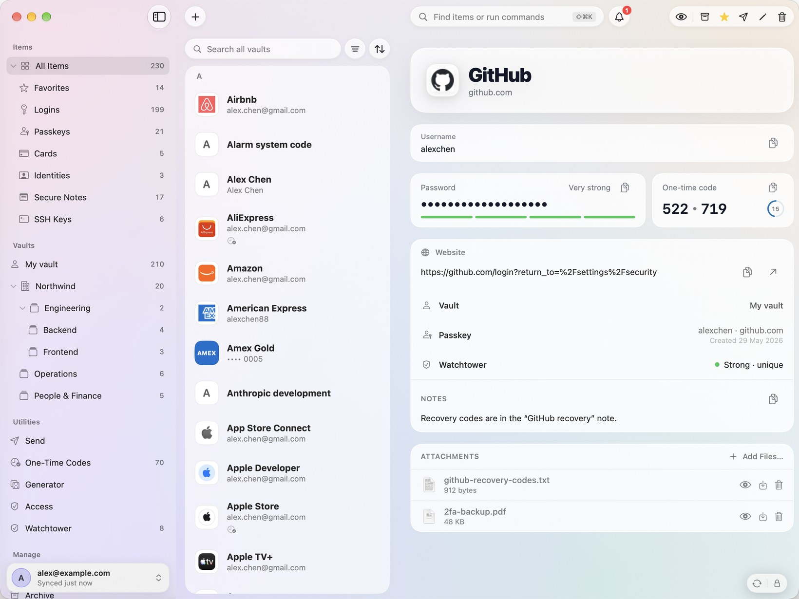

<p align="center">
  
</p>

<h1 align="center">Triwarden</h1>

<p align="center">
  <a href="https://github.com/dani-garcia/vaultwarden">Vaultwarden</a> と Bitwarden に対応する、Mac ネイティブのパスワードマネージャー。<br>
  Swift と SwiftUI で構築され、macOS 26 に対応しています。
</p>

<p align="center">
  <a href="README.md">English</a> · <a href="README.zh-Hant.md">繁體中文</a> ·
  <a href="README.zh-HK.md">粵語</a> · <a href="README.zh-Hans.md">简体中文</a> · 日本語 ·
  <a href="README.ko.md">한국어</a> · <a href="README.fr.md">Français</a> ·
  <a href="README.es.md">Español</a>
</p>

<p align="center">
  <a href="https://github.com/sinhong2011/triwarden/releases/latest/download/Triwarden.dmg"></a>
</p>

<p align="center">
  <a href="https://github.com/sinhong2011/triwarden/actions/workflows/ci.yml"></a>
  <a href="LICENSE"></a>
  
  
</p>

<p align="center">
  
</p>

> この翻訳は 2026年11月6日に[英語版 README](README.md)と同期しました。機能と技術情報の完全な一覧は英語版をご覧ください。

> **開発状況：**現在は初期リリース（0.x）です。実際の Vaultwarden および Bitwarden アカウントで動作し、
> 両方に対してテストされていますが、1.0 までは普段お使いのクライアントも残しておくことをお勧めします。スクリーンショットには内蔵のデモ保管庫を使用しています。

## インストール

macOS 26（Tahoe）以降が必要です。

```bash
brew install --cask sinhong2011/tap/triwarden
```

上のダウンロードボタンから、署名・公証済みの最新 DMG を直接入手できます。「設定 › 情報」で署名済みアップデートを確認できます。自動確認とインストールはオプトインです。

## はじめに

1. Triwarden を開き、Vaultwarden サーバー、Bitwarden US、または Bitwarden EU を選んで既存のアカウントにサインインします。
2. 「システム設定 › 一般 › 自動入力とパスワード」で Triwarden を有効にすると、パスワード、パスキー、確認コードを入力できます。
3. Triwarden では **⌘F** で保管庫を検索し、どのアプリからでも **⇧⌘Space** でコマンドパレットを開けます。
   自動入力には **Triwarden Auto-Type** のアクセシビリティ権限が必要です。ブラウザ拡張機能は設定から任意で接続できます。

**オフライン：**この Mac に暗号化して保存された保管庫は、オフラインでもロック解除して閲覧できます。項目の作成、編集、インポート、削除にはサーバー接続が必要で、変更が後から送信されることはありません。

**公式ビルドと有料ライセンス：**個人利用では、すべての機能を期限なく無料で使用できます。公式ビルドで仕事用アカウントを管理する場合は、利用者ごとに買い切りライセンスが必要です。1ライセンスで、その人が使うすべての Mac をカバーします。[有料ライセンス規約](docs/LICENSE-TERMS.md)をご覧ください。

## 機能

**Mac ネイティブの保管庫**

- ログイン、安全なメモ、カード、個人情報、SSH 鍵を、フォルダ、お気に入り、カスタムフィールド、添付ファイル、アーカイブ、ゴミ箱とともに管理できます。
- 複数の Vaultwarden／Bitwarden アカウント、共有保管庫、コレクションを同時に利用し、WebSocket でライブ同期します。パスワード、二要素認証、シングルサインオン（SSO）に対応します。
- すべての保管庫を一度に検索し、種類、フォルダ、お気に入り、ワンタイムパスワード、パスキー、Watchtower の問題で絞り込めます。
- 項目の編集画面で添付ファイルを追加、ダウンロード、削除できます。現在のブラウザタブからログインを作ると、サイト情報が自動入力されます。

**すばやいアクセス**

- どのアプリからでもコマンドパレットで項目を探し、コピーしたり、ユーザー名とパスワードを自動入力したりできます。
- グローバルショートカットを設定し、メニューバーから関連するログイン、ワンタイムパスワード、ジェネレーターにアクセスできます。
- Safari、Chrome、Edge、Brave、Firefox の拡張機能で、アプリ内の承認後にログインの入力と保存ができます。パスキーサインインには macOS のシステム自動入力を使用します。ブラウザ拡張機能ではまだパスキーサインインを処理できません。

**macOS 連携とセキュリティツール**

- システムの自動入力でパスワード、パスキー、ワンタイムパスワードに対応し、Touch ID または PIN でロック解除できます。
- コピーした機密情報はクリップボードから自動消去されます。SSH agent は保管庫の SSH 鍵で Git コミットにも署名できます。
- 画面共有、録画、スクリーンショットから Triwarden を隠せます。セルフホスト環境ではプライベート CA と Cloudflare Access などの追加リクエストヘッダーを利用できます。
- Watchtower が脆弱、再利用、漏えい、安全でないパスワードと、二要素認証を設定していないサイトを検出します。
- 二要素認証、デバイス管理、緊急アクセス、Send、パスワード／ユーザー名生成、多数のインポート・エクスポート形式に対応します。

すべての機能と制限は[英語版 README](README.md)および[ロードマップ](docs/ROADMAP.md)をご覧ください。

## コマンドラインとローカル API キー

「設定 › 開発者」で **Answer the tw command** を有効にし、**Terminal Helper Setup…** から `tw` をインストールします。

```bash
tw get github | pbcopy
tw code github
tw status
tw run
tw tools list
tw generate --length 32
tw lock
```

ローカル API キー機能は初期状態では非表示です。「設定 › 開発者 › Show Secrets」を有効にすると、「キーを保存 → ツールやプロジェクトに渡す → 承認を確認 → 再利用する」という案内付きの手順を利用できます。[入門ガイド](docs/local-api-keys-getting-started.md)をご覧ください。
各 API キー項目には、そのキーを使うツールが表示されます。「Access › Permissions」と「Access › History」で有効な権限と過去の判断を確認できます。

## ソースからビルド

macOS 26、Xcode 26、[XcodeGen](https://github.com/yonaskolb/XcodeGen)、Node.js、pnpm が必要です。

```bash
brew install xcodegen node pnpm
```

```bash
git clone https://github.com/sinhong2011/triwarden.git
cd triwarden
make run
```

`make` ですべてのコマンドを確認できます。よく使うコマンドは `make test`、`make selftest`、`make uitest`、`make snapshots` です。

## セキュリティ、アクセシビリティ、言語

マスターパスワードと鍵が Mac の外に出ることはなく、サーバーには暗号化されたデータだけが送信されます。詳細と脆弱性の非公開報告方法は [SECURITY.md](SECURITY.md) をご覧ください。

Triwarden は VoiceOver ラベル、キーボード操作、コントラストを上げる、視差効果を減らす設定に対応しています。English、繁體中文、粵語、简体中文、日本語、한국어、Français、Español、ไทยを利用できます。既知の制限は [ACCESSIBILITY.md](ACCESSIBILITY.md) に記載しています。

## サポートとコントリビューション

購入や製品に関する質問は [support@triwarden.cc](mailto:support@triwarden.cc) までご連絡ください。不具合や機能提案は [GitHub issue](https://github.com/sinhong2011/triwarden/issues) へお願いします。Issue と Pull Request を歓迎します。リリース手順は [docs/RELEASING.md](docs/RELEASING.md) をご覧ください。

## ライセンス

Triwarden は [GNU General Public License v3.0](LICENSE) の下で公開されている自由ソフトウェアです。コードのライセンスに「Triwarden」の名称とアプリアイコンは含まれません。変更版では独自の名称とアイコンを使用してください。Triwarden は Bitwarden, Inc. および Vaultwarden プロジェクトとは提携していません。
